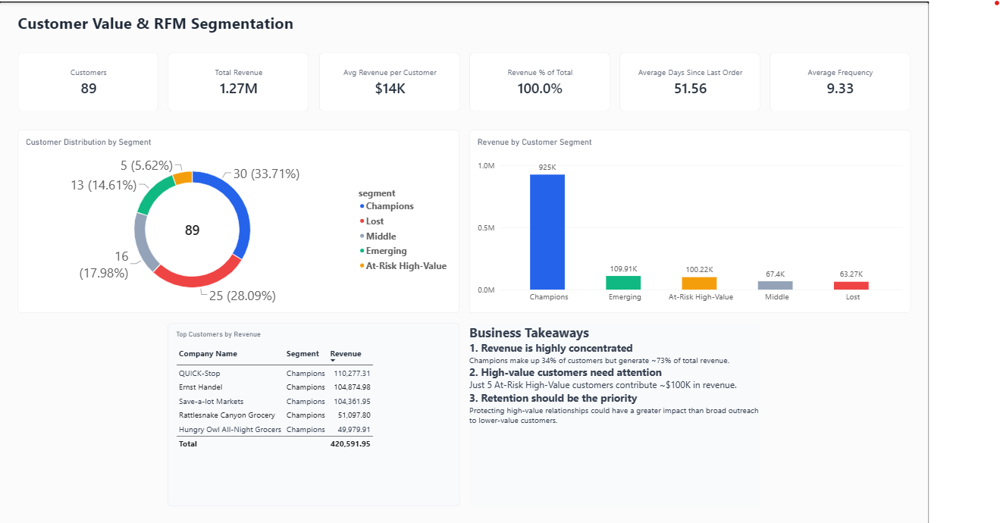
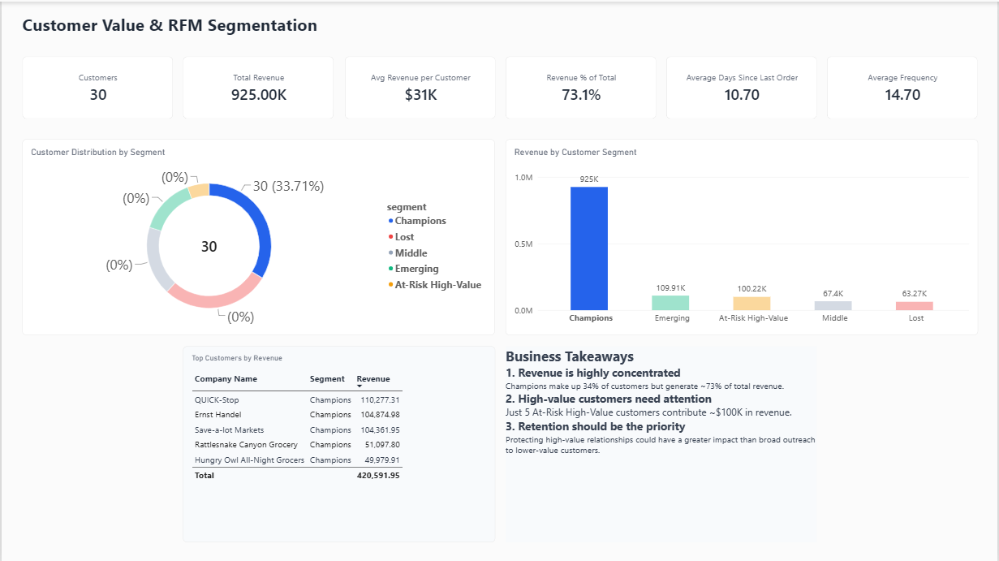
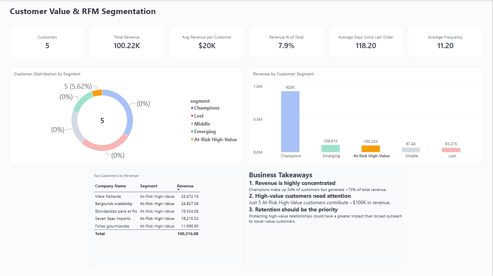
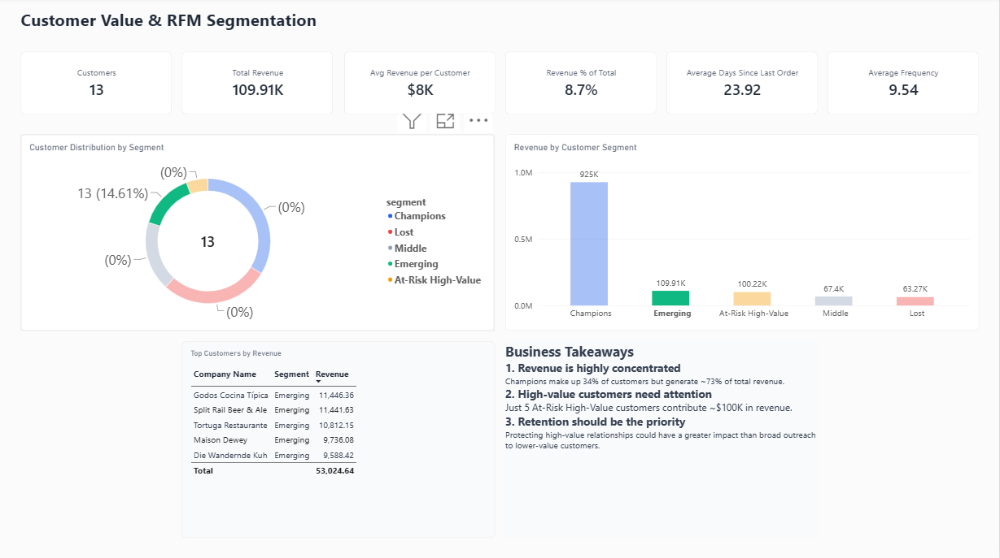
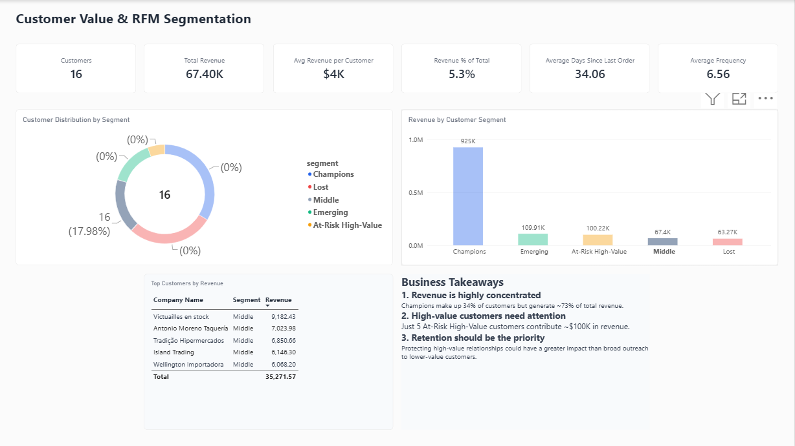
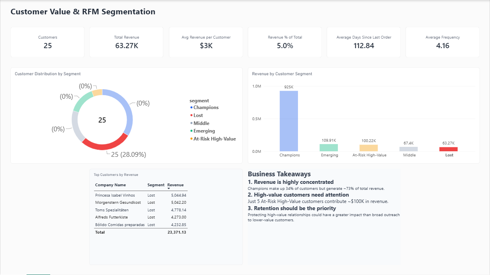

# Customer Value & RFM Segmentation Dashboard

An end-to-end customer value analysis built with the **Northwind dataset**, PostgreSQL SQL, and Microsoft Power BI.

The project transforms order-level transaction data into a reusable `rfm_analysis` view and presents the results in an interactive Power BI dashboard. The analysis is designed with a B2B perspective, giving greater importance to monetary value and customer recency than to order frequency.

## Project Overview

The dashboard answers four practical business questions:

- Which customers generate the most revenue?
- Which customers are loyal and worth protecting?
- Which high-value customers may be at risk of churn?
- How is customer value distributed across the customer base?

## Dashboard Preview

The Power BI report is titled **Customer Value & RFM Segmentation** and contains one executive summary page with:

- KPI cards for customer count, revenue, average revenue per customer, revenue share, average days since last order, and average frequency
- Customer distribution by segment
- Revenue by customer segment
- A top-five customer revenue table
- Business takeaways focused on concentration and retention priorities

### Dashboard Overview



The overview shows the full Northwind customer base. Selecting a segment filters the KPI cards and the top-customer table to that group.

<details>
<summary>View filtered segment screenshots</summary>

#### Champions



#### At-Risk High-Value



#### Emerging



#### Middle



#### Lost



</details>

## Approach

Each customer is reduced to three behaviours: how much they spend (monetary), how often they order (frequency), and how recently they ordered (recency). These are scored and combined into a segment.

1. **Monetary and frequency are scored relative to the customer base.** Customers are ranked with `DENSE_RANK()`, so equal values share a rank with no gaps, and then split into five score groups with `NTILE(5)`. A score of 5 means the top fifth of customers, not a fixed amount. Because `NTILE` assigns groups by row position, customers with identical values at a group boundary can land in adjacent scores (see Limitations).
2. **Recency is measured against each customer's own ordering pattern, not in raw days.** Raw days since the last order treats every customer the same, but ordering rhythms differ: a customer who normally orders every 10 days and has been silent for 60 is overdue, while one who normally orders every 120 days is on schedule. Recency is therefore scored as `raw_recency / avg_order_duration_customer`, where a ratio of 0.5 or less means well within the customer's usual rhythm and a ratio above 2.0 means silent for more than twice their normal gap. The average interval is weighted toward recent gaps, so a recent change in behaviour counts more than old history.
3. **The global median recency acts as a safety net.** A pure ratio can unfairly penalise very frequent buyers: a customer who orders every 3 days and last ordered 10 days ago would score poorly despite being recently active. Customers whose recency is at or below the median across all customers are therefore treated as active.
4. **Scores are weighted for a B2B context.** Monetary 50%, recency 35%, frequency 15%, because revenue impact and relationship health matter more than order count when a few accounts drive most of the revenue.
5. **Segments use monetary value and recency only.** Frequency feeds the weighted score but does not decide the segment label.

## Data Source

This project uses the Northwind sample database, specifically the following tables:

- `orders` — order headers, customer identifiers, and order dates
- `order_details` — product prices, quantities, and discounts
- `customers` — customer names and company information

Revenue is calculated at the order level using:

```sql
unit_price * quantity * (1 - discount)
```

The analysis is customer-based, with each customer represented by one final row in the `rfm_analysis` view.

## SQL View Logic

The full query is in [`sql/rfm_analysis.sql`](sql/rfm_analysis.sql). The `rfm_analysis` view is built through a sequence of common table expressions (CTEs).

### 1. `main_columns` — Base Order Aggregation

- Joins `orders` with `order_details`.
- Aggregates line-item revenue into order-level revenue.
- Preserves the customer, order, and order date.
- Calculates the latest order date in the dataset using a window function.

### 2. `durations_and_weights` — Order Timing and Weights

- Calculates the number of days between consecutive orders for each customer.
- Assigns an order weight using `ROW_NUMBER()`.
- More recent orders receive larger weights because orders are ranked chronologically.

### 3. `raw_rfm` — Raw Customer Metrics

The view calculates four customer-level metrics:

| Metric | Definition |
|---|---|
| Raw monetary | Total revenue generated by the customer |
| Raw frequency | Number of orders placed by the customer |
| Raw recency | Days since the customer's latest order relative to the latest dataset date |
| Average order duration | Weighted average time between the customer's orders |

The average order duration uses the weighted formula:

```text
sum(order_duration × order_weight) / sum(order_weight)
```

This gives greater influence to the customer's more recent purchasing intervals.

### 4. `global_stats` — Global Recency Benchmark

The query calculates the median customer recency across the full customer base (23 days in this dataset). This global median is later used as a benchmark when assigning customer segments.

### 5. `dense_ranks` — Relative Ranking and Recency Ratio

- Ranks customers by monetary value and frequency.
- Calculates the customer-specific recency ratio:

```text
raw_recency / average_order_duration_customer
```

The recency ratio compares how long a customer has been inactive with that customer's normal purchasing interval. A lower ratio generally indicates healthier engagement.

### 6. `fm_scores` — Monetary and Frequency Scores

- Divides monetary and frequency rankings into five groups using `NTILE(5)`.
- Produces scores from 1 to 5.
- A higher monetary score represents stronger revenue contribution.
- A higher frequency score represents more frequent purchasing activity.

### 7. `rfm_scores` — Recency Score

Recency is scored using the customer-specific recency ratio:

| Recency ratio | Score |
|---:|---:|
| `<= 0.5` | 5 |
| `<= 1.0` | 4 |
| `<= 1.5` | 3 |
| `<= 2.0` | 2 |
| `> 2.0` | 1 |

The scoring approach rewards customers whose latest order is recent relative to their usual ordering behavior.

Customers with only one order have no ordering interval, so their recency ratio is undefined and they receive a recency score of 1.

### 8. `weighted_rfm` — B2B-Weighted RFM Score

The final weighted score is calculated as:

```text
(monetary_score × 0.50)
+ (recency_score × 0.35)
+ (frequency_score × 0.15)
```

The weighting reflects a B2B prioritization:

- **50% Monetary** — prioritizes revenue impact
- **35% Recency** — prioritizes current relationship health
- **15% Frequency** — provides additional purchasing context

## Customer Segmentation

Segments are assigned with a SQL `CASE` expression using monetary score, recency score, and the global median recency. Conditions are checked in the order below, and each customer receives the first segment whose conditions it meets.

| # | Segment | Condition | Business interpretation |
|---:|---|---|---|
| 1 | Champions | `monetary_score >= 4` AND (`recency_score >= 4` OR `raw_recency <= global_median_recency`) | High-value customers with healthy recent engagement |
| 2 | Loyal High-Value | `monetary_score >= 4` AND `recency_score = 3` | Valuable customers with moderate engagement |
| 3 | At-Risk High-Value | `monetary_score >= 4` AND `recency_score <= 2` | Important customers requiring retention attention |
| 4 | Emerging | `monetary_score = 3` AND (`recency_score >= 4` OR `raw_recency <= global_median_recency`) | Mid-value customers showing recent engagement |
| 5 | Lost | `monetary_score <= 2` AND `raw_recency > global_median_recency` | Lower-value customers with comparatively long inactivity |
| 6 | Middle | Everything else: lower-value customers who ordered recently, and mid-value customers with weaker recency | Customers who do not meet a more specific segment |

**Note on Loyal High-Value:** this segment is defined in the logic, but no customers fall into it in this dataset. Customers whose recency is at or below the global median are assigned to Champions first, so the segment is rarely reached.

The segmentation intentionally emphasizes monetary value and recency. Frequency contributes to the weighted RFM score but does not independently determine the final segment label.

## Segment Profile

| Segment | Customers | Revenue | % of revenue | Avg days since last order | Avg orders |
|---|---:|---:|---:|---:|---:|
| Champions | 30 | 925.00K | 73.1% | 10.70 | 14.70 |
| Emerging | 13 | 109.91K | 8.7% | 23.92 | 9.54 |
| At-Risk High-Value | 5 | 100.22K | 7.9% | 118.20 | 11.20 |
| Middle | 16 | 67.40K | 5.3% | 34.06 | 6.56 |
| Lost | 25 | 63.27K | 5.0% | 112.84 | 4.16 |
| **All customers** | **89** | **1.27M** | **100%** | **51.56** | **9.33** |

## Dashboard KPIs

The overview page shows the following headline metrics:

| KPI | Value |
|---|---:|
| Customers | 89 |
| Total revenue | 1.27M |
| Average revenue per customer | $14K |
| Average days since last order | 51.56 |
| Average frequency | 9.33 orders per customer |

## Dashboard Insights

1. **Revenue is highly concentrated.** Champions are 30 of 89 customers (about 34%) but generate about 73% of total revenue.
2. **High-value customers are slipping away.** The five At-Risk High-Value customers contribute about $100K in revenue. They averaged 11.2 orders each, close to the 14.7 for Champions, but have gone an average of 118 days since their last order, compared with about 11 days for Champions.
3. **The inactive group is large but low-value.** Lost customers are 25 of 89 (about 28%) but generate only 5.0% of revenue, so reactivating them is a smaller opportunity than retaining the At-Risk High-Value accounts.

## Recommendation

Retention effort is best focused on the five At-Risk High-Value accounts (about $100K in revenue) rather than spread evenly across lower-value customers.

## Top Customers by Revenue

The dashboard highlights the following top customers:

| Company | Segment | Revenue |
|---|---|---:|
| QUICK-Stop | Champions | 110,277.31 |
| Ernst Handel | Champions | 104,874.98 |
| Save-a-lot Markets | Champions | 104,361.95 |
| Rattlesnake Canyon Grocery | Champions | 51,097.80 |
| Hungry Owl All-Night Grocers | Champions | 49,979.91 |

These five customers contribute about $420.6K in combined revenue, reinforcing the importance of account-level retention for the highest-value customers.

## Limitations

- Northwind is a small sample dataset (89 customers with orders), so segment sizes are small and sensitive to threshold choices.
- `NTILE(5)` splits customers into near-equal groups and does not keep tied values together, so customers with the same order count can land in different frequency scores.
- Customers with a single order always receive a recency score of 1, because no ordering interval can be calculated for them.
- The segment thresholds and the 50/35/15 weights are judgment-based choices for a B2B context, not fitted values.

## Technology Used

- **SQL** for customer-level aggregation, window functions, ranking, scoring, and segmentation
- **PostgreSQL-style SQL** for the `CREATE OR REPLACE VIEW`, decimal casting, date arithmetic, and percentile calculation
- **Microsoft Power BI Desktop** for KPI cards, segment distribution, revenue comparison, customer ranking, and business commentary

## Reproducing the Analysis

1. Load the Northwind sample database into PostgreSQL using the script from [pthom/northwind_psql](https://github.com/pthom/northwind_psql).
2. Create or replace the `rfm_analysis` view using [`sql/rfm_analysis.sql`](sql/rfm_analysis.sql).
3. Connect Power BI to the resulting view.
4. Build the report using the customer, revenue, RFM score, and segment fields.
5. Refresh the Power BI model whenever the underlying Northwind data changes.

If the query is executed in SQL Server instead of PostgreSQL, the PostgreSQL-specific casts and date arithmetic may need to be adapted.

## Purpose

This project demonstrates how SQL-based customer segmentation can support practical B2B decisions. The output is intended to help prioritize retention, identify valuable accounts at risk, and focus commercial attention where it can have the greatest revenue impact.

## Acknowledgements

The Northwind sample database originates from Microsoft and is distributed under the Microsoft Public License (Ms-PL). The PostgreSQL adaptation used here is [pthom/northwind_psql](https://github.com/pthom/northwind_psql). The dataset itself is not redistributed in this repository.
